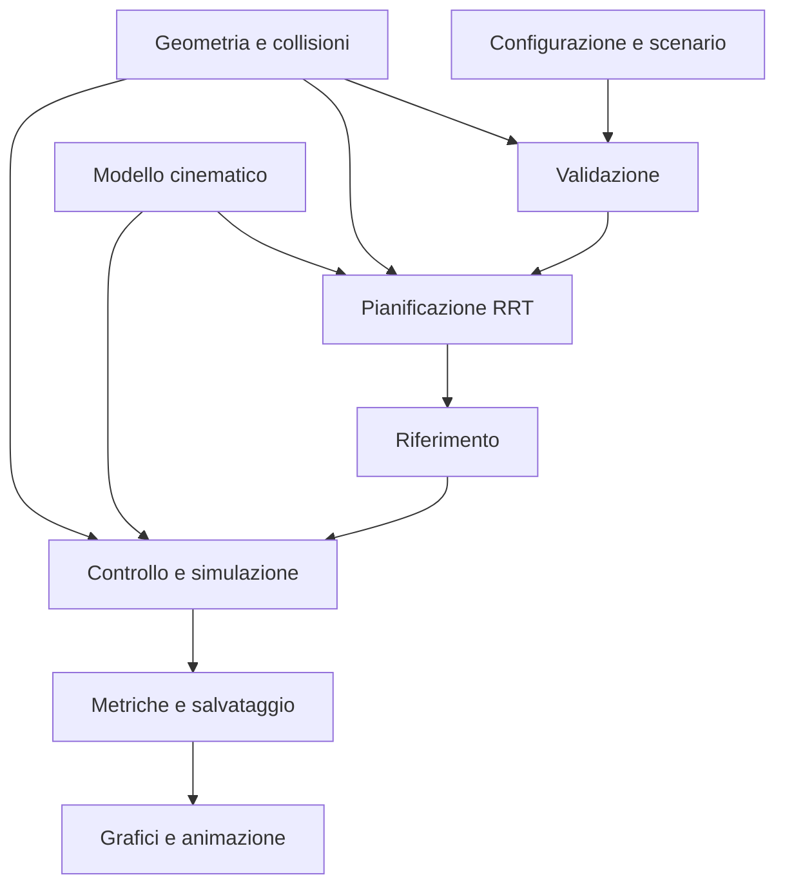

# Analisi e progettazione

**Progetto:** PIANIFICAZIONE E CONTROLLO DI UN ROBOT MOBILE DIFFERENZIALE  
**Data:** 7 novembre 2026  
**Stato:** pianificazione nel §4.7, controllo/simulazione nel §4.8, analisi e visualizzazione della FASE 6 nel §4.9. Lo stato corrente è in [Checklist_Requisiti.md](Checklist_Requisiti.md); il modello riutilizzato è descritto in [02_Modello_Cinematico.md](02_Modello_Cinematico.md). Nessun codice MATLAB, test, simulazione o generazione di figure eseguito durante questa fase.

## Premessa e criteri di lettura

La fonte dei requisiti didattici è [TRACCIA_Robot_Mobile_Differenziale.md](../TRACCIA_Robot_Mobile_Differenziale.md), trascrizione del PDF indicato nella traccia. Questa analisi riguarda il Markdown disponibile: non costituisce un confronto con il PDF originale, che non è presente nella cartella. Le note editoriali tra parentesi quadre e le note di trascrizione aiutano l'interpretazione e non aggiungono obblighi del docente. I vincoli operativi sono in [AGENTS.md](../AGENTS.md) e [README.md](../README.md), integrati dalle richieste dell'utente.

Si distinguono quattro categorie:

- **T:** requisito esplicito della traccia, da soddisfare nella consegna finale.
- **A:** requisito di un metodo alternativo, applicabile solo se quel metodo viene implementato.
- **O:** vincolo operativo del progetto richiesto dall'utente.
- **D:** scelta progettuale o criterio di verifica proposto qui; non è un dato assegnato dalla traccia.

Ogni parametro numerico successivo è una proposta iniziale, non il risultato di una taratura. Le condizioni di accettazione sono obiettivi da verificare. L'esito attuale delle verifiche numeriche è **NON ESEGUITO**. Le firme qui riportate sono contratti concettuali; per i contratti realizzati in FASE 3 prevale il documento del modello cinematico. La consegna definitiva è un PDF autonomo con link al repository GitHub; i sorgenti integrali sono nel repository e non sono obbligatori nel PDF. Non pubblicare ancora il repository.

## 1. Matrice di tracciabilità dei requisiti

### 1.1 Requisiti comuni della traccia

I riferimenti di sezione in questa tabella si riferiscono al Markdown della traccia. Le sigle dei test sono definite nel §7 di questo documento.

| ID | Fonte | Requisito | Decisione e modulo previsto | Evidenza prevista |
| --- | --- | --- | --- | --- |
| T01 | §1 | Robot nel piano XY con due ruote motrici indipendenti | Stato in SE(2), ingressi delle due ruote, `model` | UT-M01–M05; modello nella relazione |
| T02 | §1 | Sistema completo di modellazione cinematica | Cinematica diretta, inversa e propagazione condivisa | UT-M01–M05 |
| T03 | §1 | Pianificare in presenza di ostacoli | RRT con archi generati dal modello, `planning` e `geometry` | UT-P01–P06; IT01–IT05 |
| T04 | §1 | Controllare il moto lungo il percorso pianificato | Riferimento ordinato e controllore ibrido a waypoint | UT-C01–C06; IT01–IT04 |
| T05 | §1 | Simulazione e visualizzazione in MATLAB | Simulatore cinematico, grafici e animazione con MATLAB standard | UT-S01–S03; IT01, IT06 |
| T06 | §1, vincolo esplicito | Modello esclusivamente differenziale in pianificazione e controllo | Archi con comandi ruota e durata; controllore sempre convertito in comandi ruota | UT-M05, UT-P02–P03, UT-C05; audit dei log |
| T07 | §2.1 | Stato `q = [x,y,theta]^T` | Singolo stato `3×1`; archivi con uno stato per riga | UT-D01; contratti del §5 |
| T08 | §2.1 | Ingressi `omega_R`, `omega_L` | Ordine fisso destra, sinistra; rad/s | UT-M01–M04, UT-D01 |
| T09 | §2.1 | `v = r(omega_R+omega_L)/2` | Cinematica diretta con raggio comune positivo | UT-M01–M04 |
| T10 | §2.1 | `omega = r(omega_R-omega_L)/d` | `d` come distanza tra le ruote; convenzione antioraria positiva | UT-M01–M04 |
| T11 | §2.1 | Tre equazioni di moto assegnate | Unica funzione di derivata e propagatore coerente | UT-M02–M05 |
| T12 | §3 | Ambiente rettangolare | Confini espliciti e validazione dell'intero ingombro | UT-G01–G04 |
| T13 | §3 | Ostacoli circolari o poligonali modellati e visualizzati | Supporto a cerchi e poligoni semplici, anche misti | UT-G01–G03; IT06 |
| T14 | §3 | Configurazione iniziale `q_0` | Validazione di forma, finitezza e collisioni | UT-D01, UT-P01; S6 |
| T15 | §3 | Configurazione finale `q_f` | Verifica di posizione e orientamento finali | UT-C03–C04; S7–S8 |
| T16 | §4 | Implementare almeno uno dei metodi ammessi | Scelta della famiglia RRT, variante con vincoli differenziali | UT-P01–P06; IT01–IT05 |
| T17 | §5.1 | Convertire il percorso in waypoint o riferimento continuo | Stati, primitive e waypoint ordinati, senza perdere le rotazioni sul posto | UT-R01–R03 |
| T18 | §5.2 | Controllore del tipo `v=k_rho*rho`, `omega=k_alpha*alpha` | Legge nominale nella modalità di avanzamento, con allineamento, limiti e arresto | UT-C01–C06; IT01–IT04 |
| T19 | §5.3 | Convertire `v,omega` in velocità delle ruote | Cinematica inversa e saturazione comune | UT-M04, UT-C05 |
| T20 | §5.4 | Simulare tramite integrazione numerica | RK4 a passo fissato, più riferimento analitico indipendente per controlli costanti | UT-S01–S03; IT01–IT04 |
| T21 | §6 | Traiettoria pianificata | Grafico XY e dati di stato/orientamento del piano | IT06; §8.6 |
| T22 | §6 | Traiettoria eseguita | Sovrapposizione XY e log temporali effettivi | IT06; §8.6 |
| T23 | §6 | Errore di tracking | Distanza dal tratto attivo, errore al waypoint e errore finale distinti | UT-L01; IT01–IT04 |
| T24 | §6 | Andamento velocità delle ruote | Grafici `omega_R(t)`, `omega_L(t)` e limiti | UT-L01; IT06 |
| T25 | §6 | Animazione del moto | Corpo, direzione e ruote, ostacoli e traiettorie nello stesso sistema XY | IT06; file animazione e riferimento nel PDF |

L'orientamento finale è trattato come parte di T15 perché la traccia assegna una configurazione `q_f`, non soltanto un punto. Non si assume che la sola distanza XY esaurisca il requisito.

### 1.2 Requisiti specifici dei tre metodi ammessi

| ID | Fonte | Requisito | Applicabilità e soluzione | Evidenza prevista |
| --- | --- | --- | --- | --- |
| A-CD01 | §4.1.1 | Suddividere in celle libere e occupate | Alternativa non selezionata; eventuale discretizzazione conservativa dell'ingombro | Confronto nel §3; nessuna implementazione promessa |
| A-CD02 | §4.1.2 | Grafo di adiacenza delle celle libere | Alternativa non selezionata; adiacenze e attraversamenti validati | Come sopra |
| A-CD03 | §4.1.3 | Retraction di ogni cella a nodo o segmento centrale | Alternativa non selezionata; centri/portali e costruzione esplicita della riduzione | Come sopra |
| A-CD04 | §4.1.4 | Ricerca inizio-fine, per esempio Dijkstra | Alternativa non selezionata; ricerca su grafo | Come sopra |
| A-CD05 | §4.1, output | Waypoint `(x_i,y_i)` collision-free | Alternativa non selezionata; sollevamento successivo a moti differenziali necessario | Come sopra |
| A-R01 | §4.2.1 | Generare configurazioni casuali collision-free | **Applicabile**: bersagli casuali validi in SE(2), nuovi nodi accettati soltanto dopo propagazione valida | UT-P01–P03 |
| A-R02 | §4.2.2 | Collegare nodi con archi validi | **Applicabile**: albero diretto con controlli ruota, durate e verifica dell'intero arco | UT-P02–P03 |
| A-R03 | §4.2.3 | Cercare un percorso da `q_0` a `q_f` | **Applicabile**: espansione dalla radice e risalita dei genitori dopo connessione al goal | UT-P04–P05 |
| A-R04 | §4.2.4 | Estrarre una traiettoria planare continua | **Applicabile**: concatenazione delle soluzioni cinematiche con stato continuo ai nodi | UT-P02, UT-R01 |
| A-R05 | §4.2, output | Sequenza di configurazioni o punti nel piano | **Applicabile**: configurazioni, primitive e campioni XY; informazioni cinematiche conservate | UT-R01–R03 |
| A-F01 | §4.3.1 | Potenziale attrattivo e potenziali repulsivi | Alternativa non selezionata; confronto teorico | §3 |
| A-F02 | §4.3.2 | Gradiente del potenziale totale | Alternativa non selezionata; confronto teorico | §3 |
| A-F03 | §4.3.3 | Gradiente usato per generare direzione di moto | Alternativa non selezionata; richiederebbe conversione in comandi differenziali | §3 |
| A-F04 | §4.3.4 | Discussione dei minimi locali | Alternativa non selezionata; criticità discussa comunque nel confronto | §3 |
| A-F05 | §4.3, output | Traiettoria continua nel piano | Alternativa non selezionata; continuità da verificare sul modello | §3 |

I requisiti delle due famiglie non scelte sono **non applicabili all'implementazione principale**, non requisiti dimenticati. PRM e RRT sono alternative della stessa famiglia: non occorre implementarli entrambi.

### 1.3 Vincoli operativi e scelte di progetto tracciate

| ID | Origine | Vincolo o decisione | Applicazione | Evidenza prevista |
| --- | --- | --- | --- | --- |
| O01 | Decisione corrente dell'utente | Codice MATLAB compatibile desktop/Online; prova reale successiva in MATLAB Online | Nessuna esecuzione ora, nessun Octave o toolbox specialistico | Registro futuro della prova in MATLAB Online |
| O02 | Utente, AGENTS | MATLAB standard senza dipendenze da Octave o toolbox aggiuntivi | Algoritmi propri e funzioni base; niente API Robotics, Navigation, Statistics, Mapping o Simulink | UT-D02 e revisione delle dipendenze |
| O03 | Utente | Nessuna installazione | Nessun comando di installazione o ambiente aggiunto | Revisione della procedura di consegna |
| O04 | Utente, AGENTS | Revisione statica approfondita | Sintassi, firme, dimensioni, formule, compatibilità, casi limite e coerenza | Checklist del §7.2 |
| O05 | Utente | Test automatici senza dichiararli superati prima dell'esecuzione | Test standard MATLAB, stato NON ESEGUITO fino a evidenza reale | Registro test con esiti e messaggi |
| O06 | Utente | Punti di ingresso `main.m` e `run_tests.m` | Preservare i nomi, estenderli solo in fase di implementazione | UT-D01–D02 |
| O07 | Utente | Percorsi relativi e indipendenza dal sistema operativo | `fullfile`, cartella dei sorgenti, niente shell o percorsi personali | UT-D02 |
| O08 | Utente | Progetto completo per MATLAB Online | Sorgenti, dati, scenari, test e istruzioni inclusi nella consegna | IT07 e checklist di consegna |
| O09 | Decisione definitiva dell'utente | Unico PDF autonomo con risultati effettivi e link al repository GitHub | Metodi, implementazione, validazione e conclusioni nel PDF; sorgenti nel repository, non obbligatori nel PDF | §8; audit finale |
| O10 | Utente | Non eseguire simulazioni ora | Sviluppo e revisione statica; esecuzioni solo nella fase dedicata in MATLAB Online | Nessun log numerico presentato come risultato |
| O11 | FASE 6, decisione corrente | Implementare soltanto analisi e visualizzazioni dai dati effettivi | Grafici, animazione, PNG, riepilogo e controlli di coerenza; nessuna esecuzione o fase successiva | Checklist corrente; nessun PDF definitivo o pubblicazione |
| D01 | Progetto | Parametri non assegnati da scegliere e dichiarare | Tabella del §6, nessun valore attribuito al docente | Configurazione futura e relazione |
| D02 | Progetto | Corpo contenuto in un disco e margine di sicurezza | Collisioni indipendenti dall'orientamento sotto tale ipotesi | UT-G01–G04 |
| D03 | Progetto | RRT con propagazione cinematica | Il piano contiene una prova costruttiva di fattibilità mediante comandi e durate | UT-M05, UT-P02–P03 |
| D04 | Progetto | Terminazioni esplicite e riproducibilità | Stati di uscita, seed e budget salvati | UT-P04–P06; IT05 |
| D05 | Progetto | Sicurezza verificata anche sul moto eseguito | Controllo dell'arco di ogni passo; arresto in caso di rischio | UT-C06; IT03–IT04 |

### 1.4 Collegamento ai criteri di valutazione

| Criterio della traccia | Peso | Elementi della consegna che lo rendono valutabile |
| --- | --- | --- |
| Modello differenziale corretto | 20% | Equazioni, convenzioni, test analitici, residuo non olonomo e replay degli archi |
| Pianificazione del moto | 20% | RRT spiegato, validazione continua degli archi, casi riusciti e fallimenti documentati |
| Controllo del robot | 20% | Legge nominale, modalità ibride, orientamento finale, saturazioni e tracking |
| Analisi dei risultati | 20% | Metriche definite, scenari riproducibili, confronto tra seed e sensibilità |
| Qualità codice e animazione | 20% | Contratti, moduli, test automatici, portabilità, repository completo e animazione |

La traccia non richiede ottimalità globale, ostacoli mobili, dinamica delle coppie, sensori, SLAM o apprendimento. Tali estensioni non fanno parte della soluzione di base.

## 2. Modello cinematico e vincoli non olonomi

### 2.1 Riferimenti, stato e ipotesi

Si assume un piano fisso con assi X e Y, angolo `theta` misurato da X in senso antiorario. L'origine solidale al robot è il punto medio dell'asse delle due ruote. Lo stato è

\[
q=\begin{bmatrix}x&y&\theta\end{bmatrix}^{T}\in\mathbb{R}^{2}\times S^{1}.
\]

Le ruote hanno raggio comune `r > 0`; `d > 0` è la distanza tra i loro piani mediani, non la semidistanza. Le velocità angolari positive fanno avanzare le rispettive ruote. Si assumono rotolamento senza slittamento, terreno piano, geometria rigida, ostacoli statici e stato noto esattamente. Errori di stima e aderenza non sono modellati nella soluzione di base.

**Scelta aggiuntiva necessaria:** entrambe le ruote possono ruotare nei due versi. Questo consente la rotazione sul posto. Il pianificatore principale limiterà comunque la velocità del centro a `v >= 0`; le ruote possono avere segno opposto durante le sterzate. Se si imponesse a entrambe le ruote di girare solo in avanti, molte manovre e il connettore finale qui descritti dovrebbero essere riprogettati.

Il corpo completo, incluse le ruote, è contenuto in un disco di raggio `R_body` centrato nell'origine del robot. È un'ipotesi conservativa da dichiarare, non un dato della traccia. Una sagoma non circolare richiederebbe collisioni dipendenti da `theta`, soprattutto durante le rotazioni.

### 2.2 Cinematica diretta e inversa

Con `u = [omega_R; omega_L]`:

\[
\begin{bmatrix}v\\\omega\end{bmatrix}
=\begin{bmatrix}r/2&r/2\\r/d&-r/d\end{bmatrix}
\begin{bmatrix}\omega_R\\\omega_L\end{bmatrix},
\qquad
\dot q=\begin{bmatrix}v\cos\theta\\v\sin\theta\\\omega\end{bmatrix}.
\]

L'inversione, valida per `r,d > 0`, è

\[
\omega_R=\frac{v+(d/2)\omega}{r},\qquad
\omega_L=\frac{v-(d/2)\omega}{r}.
\]

Le dimensioni sono: `x,y,r,d` in metri; `theta` in radianti; `v` in m/s; `omega,omega_R,omega_L` in rad/s. L'ordine destra/sinistra deve restare identico in tutti i moduli.

Se ogni ruota è limitata da `abs(omega_i) <= Omega_max`, l'insieme ammissibile in velocità del corpo è

\[
|v+(d/2)\omega|\le r\Omega_{\max},\qquad
|v-(d/2)\omega|\le r\Omega_{\max}.
\]

In modo equivalente, `abs(v) + (d/2)*abs(omega) <= r*Omega_max`. Limitare separatamente `v` e `omega` non è sufficiente. Il progetto prevede prima limiti di esercizio su `v,omega`, poi conversione alle ruote e, se serve, una riduzione comune di entrambe le velocità tramite un fattore `lambda <= 1`. La riduzione comune conserva il rapporto fra `v` e `omega`; il clipping indipendente delle ruote può cambiare la curvatura. Le velocità effettive dopo saturazione devono essere ricalcolate e registrate.

### 2.3 Vincolo non olonomo

L'assenza di velocità laterale impone

\[
-\sin\theta\,\dot x+\cos\theta\,\dot y=0,
\quad\text{ossia}\quad
A(q)\dot q=0,\qquad A(q)=\begin{bmatrix}-\sin\theta&\cos\theta&0\end{bmatrix}.
\]

La velocità traslazionale deve essere parallela all'asse longitudinale del robot. Per esempio, con `theta = 0`, la velocità `[dot x,dot y] = [0,1]` è vietata. Lo stesso spostamento laterale può essere ottenuto nel tempo mediante rotazioni e avanzamenti: il vincolo riguarda la velocità istantanea e non elimina una coordinata dello stato mediante una semplice equazione di posizione.

Una lista di punti XY, anche collision-free, non specifica `theta(t)`, `v(t)` e `omega(t)` e non dimostra questo vincolo. Analogamente, interpolare linearmente tre componenti di due stati SE(2) può produrre velocità laterale. Non si userà tale interpolazione per validare archi.

Per il modello differenziale ideale la rotazione sul posto è ammessa: con `omega_R = -omega_L` si ha `v = 0`. Non esiste quindi un raggio minimo di sterzata positivo indipendente dalla velocità, come per un veicolo automobilistico. Per `v != 0` la curvatura istantanea è `kappa = omega/v`; per `v = 0` questa espressione non va valutata. La possibilità di ruotare e poi traslare è descritta anche nel [modello differential drive di LaValle](https://msl.cs.illinois.edu/~lavalle/planning/node659.html).

### 2.4 Propagazione degli archi e integrazione della simulazione

Per comandi delle ruote costanti e durata `tau > 0`, anche `v,omega` sono costanti. Se `omega != 0`:

\[
x_1=x_0+\frac{v}{\omega}\left[\sin(\theta_0+\omega\tau)-\sin\theta_0\right],
\]
\[
y_1=y_0-\frac{v}{\omega}\left[\cos(\theta_0+\omega\tau)-\cos\theta_0\right],
\qquad \theta_1=\theta_0+\omega\tau.
\]

Per `omega = 0`, il limite è `p_1 = p_0 + v*tau*[cos(theta_0); sin(theta_0)]`, con orientamento costante. Per evitare cancellazioni numeriche quando `omega*tau` è piccolo si può usare la forma equivalente

\[
\Delta p=v\tau\,\operatorname{sinc}_0(\omega\tau/2)
\begin{bmatrix}\cos(\theta_0+\omega\tau/2)\\\sin(\theta_0+\omega\tau/2)\end{bmatrix},
\quad \operatorname{sinc}_0(z)=\begin{cases}\sin z/z&z\ne0\\1&z=0.\end{cases}
\]

Qui `sinc_0` è una definizione matematica; non si assume una funzione MATLAB `sinc` con la stessa normalizzazione o disponibilità. Il suo limite va trattato con un criterio numericamente stabile.

**Pianificazione:** propagazione analitica a comandi costanti per generare e riprodurre ogni arco.  
**Simulazione futura:** integrazione numerica RK4 del medesimo campo cinematico, comandi mantenuti costanti nel singolo passo e controllore aggiornato a ogni passo. Questo soddisfa la richiesta esplicita di integrazione numerica e consente il confronto con un riferimento analitico senza usare due formule identiche come unica verifica.

Lo stato è continuo alle giunzioni; i comandi possono essere discontinui. Le equazioni valgono su ogni intervallo e quasi ovunque sull'intera traiettoria. Limiti di accelerazione e dinamica degli attuatori non sono assegnati e non vengono dichiarati rispettati. Un'eventuale estensione dinamica richiederebbe ulteriori vincoli e una nuova validazione degli archi.

### 2.5 Angoli e configurazione finale

Le differenze angolari si calcolano mediante `atan2(sin(delta),cos(delta))`, senza richiedere `wrapToPi`. Al taglio `±pi` serve una convenzione deterministica. Nei log può essere mantenuto anche l'angolo non avvolto per evitare discontinuità artificiali nei grafici; il confronto delle pose usa sempre la differenza avvolta.

La condizione finale richiede contemporaneamente distanza XY entro `epsilon_goal` ed errore angolare entro `epsilon_theta`. A posizione raggiunta, il controllore deve passare a una modalità dedicata di allineamento: la sola legge verso un waypoint non stabilizza automaticamente un `theta_f` arbitrario e l'angolo di direzione è indefinito a distanza nulla.

## 3. Confronto dei metodi di pianificazione ammessi

### 3.1 Quadro comparativo

| Aspetto | Cell Decomposition con Retraction | PRM o RRT | Artificial Potential Fields |
| --- | --- | --- | --- |
| Idea | Celle libere, riduzione a nodi/segmenti, grafo e ricerca | Campionamento di configurazioni; roadmap PRM o albero RRT | Direzione ottenuta dal gradiente di attrazione e repulsione |
| Spazio naturale | XY per robot disco; SE(2) se la sagoma dipende dall'orientamento | XY o SE(2); il modello può entrare nel connettore o nella propagazione | XY o SE(2), con conversione esplicita in ingressi ammissibili |
| Adeguamento differenziale | Trasformare e validare ogni connessione come manovra, incluse rotazioni nei nodi | RRT a ingressi campionati genera direttamente archi del modello; PRM richiede un connettore valido | Il gradiente non è una velocità traslazionale libera: occorre sterzare e ripropagare il modello |
| Punti di forza | Struttura leggibile, ricerca ripetibile, facile diagnosi su griglia | Adatto a una singola query e allo spazio di configurazione; controlli registrabili | Legge locale semplice e interpretazione intuitiva delle forze |
| Difficoltà | Decomposizione esatta e retraction; risoluzione e ingombro per griglie | Seed, budget, passaggi stretti e scelta di metrica/estensione | Minimi locali, oscillazioni, singolarità vicino agli ostacoli e dipendenza dai guadagni |
| Fallimento | Nessun cammino nel grafo; può dipendere dalla discretizzazione | Budget esaurito non dimostra inesistenza di un cammino | Stallo prima del goal anche con percorso esistente |
| Qualità del percorso | Ottimo rispetto ai pesi del grafo, non necessariamente al problema continuo | RRT base non ottimizza globalmente lunghezza o tempo | Nessuna garanzia generale di percorso breve o arrivo |
| Risorse | Celle e archi possono crescere molto aumentando la risoluzione | Costo delle espansioni e delle verifiche degli archi; albero limitato dal budget | Poco costo per aggiornamento, ma possibile mancata convergenza |
| Implementazione base MATLAB | Matrici, liste di adiacenza e Dijkstra propri | Liste di nodi/genitori e ricerca del vicino con operazioni base | Algebra e geometria proprie, più controllo e gestione degli stalli |
| Ruolo nel progetto | Alternativa deterministica ragionevole | **Famiglia scelta: RRT con vincoli differenziali** | Alternativa discussa; non usata per assicurare il completamento |

### 3.2 Cell Decomposition con Retraction

Una soluzione possibile partiziona lo spazio libero del centro del robot in celle semplici, identifica adiacenze e portali, riduce ciascuna cella a un nodo o segmento centrale e cerca sul grafo. La connessione dentro celle convesse e la costruzione della roadmap sono trattate nella [decomposizione cellulare di LaValle](https://msl.cs.uiuc.edu/~lavalle/planning/node262.html).

In una griglia conservativa non basta che il centro di una cella sia libero: occorre stabilire la libertà dell'intera cella o validare precisamente gli attraversamenti. Le diagonali richiedono attenzione al taglio degli angoli. La risoluzione può cancellare corridoi realmente attraversabili. La riduzione di ciascuna cella al proprio centro, considerata isolatamente, non dimostra l'esistenza di una retraction globale continua dello spazio libero sul grafo: una realizzazione di questa alternativa dovrebbe esplicitare anche raccordi e portali, senza attribuire al semplice campionamento dei centri una proprietà topologica non dimostrata.

Per il robot disco reversibile una polilinea libera può essere realizzata ruotando sul posto e avanzando su ciascun segmento. La fattibilità richiede controlli e durate espliciti, verifica dell'ingombro anche durante le rotazioni e arresto ai vertici, se non si costruiscono raccordi cinematici. Spostare soltanto un punto tra celle o assegnare una velocità laterale resta vietato. Se si minimizza soltanto la lunghezza XY, il costo delle rotazioni scompare artificialmente: un costo di tempo richiede anche l'orientamento d'ingresso al nodo.

### 3.3 PRM e RRT

PRM costruisce una roadmap riutilizzabile per più query nello stesso ambiente; RRT cresce da una configurazione iniziale ed è adatto al caso di una query iniziale-finale per scenario. In entrambi i casi nodi validi non implicano archi validi. In SE(2) occorre definire orientamento, connettore e controllo delle collisioni lungo ogni collegamento.

La scelta proposta è un RRT in cui l'estensione deriva da ingressi ammissibili del robot, coerentemente con la distinzione tra pianificazione geometrica e [pianificazione sotto vincoli differenziali](https://msl.cs.uiuc.edu/planning/node713.html). Un RRT geometrico standard che collega punti XY non basta, da solo, a soddisfare il vincolo della traccia.

Le garanzie asintotiche di alcuni algoritmi di campionamento dipendono da precise ipotesi. Per l'implementazione qui proposta, con budget finito, selezione euristica dei candidati e durate limitate, non si dichiara completezza probabilistica né ottimalità senza una dimostrazione dedicata. I passaggi stretti possono essere difficili anche se esiste un percorso.

### 3.4 Artificial Potential Fields

Un esempio di formulazione usa `U_att(p) = k_att*norm(p-p_goal)^2/2` e una repulsione, per distanza libera positiva `delta` entro una soglia `delta_0`, proporzionale a `(1/delta - 1/delta_0)^2/2`. La direzione desiderata deriva da `-grad(U_att + sum(U_rep))`.

L'aggiornamento diretto di XY lungo tale direzione ignora l'orientamento del robot. Per ottenere un moto differenziale bisogna trasformare la direzione in un riferimento di orientamento, applicare comandi ammissibili, propagare il modello e verificare il moto reale. Tale modifica può alterare la discesa del potenziale: non trasferisce automaticamente eventuali proprietà del sistema olonomo.

Il gradiente può annullarsi fuori dal goal, soprattutto in concavità e ambienti simmetrici; vicino agli ostacoli la repulsione può diventare singolare, e in corridoi possono apparire oscillazioni. La difficoltà di evitare minimi locali è descritta nelle [navigation functions di LaValle](https://msl.cs.uiuc.edu/~lavalle/planning/node391.html). Strategie di fuga introducono ulteriori scelte e non equivalgono a una garanzia generale di arrivo. Lo scenario a U del §6 serve a rendere concreto questo rischio nel confronto teorico; non è richiesto implementare APF per effettuare il confronto.

## 4. Scelta motivata e verifica della compatibilità differenziale

### 4.1 Decisione principale

Si seleziona **RRT nello spazio SE(2), con espansioni generate da comandi delle ruote mantenuti costanti**. La motivazione principale è rendere la compatibilità differenziale parte della costruzione del piano: ogni arco possiede stato iniziale, comandi, durata e propagazione verificabile. Il costo aggiuntivo di campionamento e collision checking è accettabile per un ambiente bidimensionale didattico, ma deve essere misurato in seguito.

L'approccio evita di presentare una sola polilinea come prova di fattibilità. Rispetto a una cell decomposition completa richiede meno costruzioni geometriche/topologiche specifiche; rispetto a un campo potenziale non dipende soltanto da una direzione locale che può arrestarsi in un minimo. La soluzione resta più complessa di un RRT geometrico e può fallire entro il budget: tali limiti saranno riportati.

### 4.2 Sequenza logica del pianificatore

1. Validare parametri, geometrie, `q_0` e `q_f`. Non correggere silenziosamente pose in collisione.
2. Inserire `q_0` come radice dell'albero, senza arco entrante.
3. Campionare una configurazione bersaglio con XY uniforme entro i confini e orientamento uniforme su un giro; rifiutare configurazioni in collisione. Con probabilità `p_goal`, usare `q_f` come bersaglio. Limitare anche i tentativi di campionamento per iterazione: il rejection sampling non deve diventare un ciclo senza termine.
4. Cercare un nodo vicino con metrica `sqrt(norm(p_a-p_b)^2 + (ell_theta*wrap(theta_a-theta_b))^2)`, dove `ell_theta` converte radianti in metri equivalenti. È una metrica euristica per la ricerca, non una distanza minima di guida.
5. Dal nodo selezionato generare 24 candidati: uno di avanzamento rettilineo al limite di esercizio, due di rotazione pura nei due versi al limite di esercizio e 21 coppie casuali di velocità delle ruote. Per queste ultime proporre valori uniformi nell'intervallo simmetrico dei limiti ruota, rifiutare somme negative, poi ridurre entrambi i valori con un fattore comune se sono superati i limiti di esercizio di `v` o `omega`. Limitare i tentativi di estrazione anche dei controlli: un numero insufficiente di candidati determina un'espansione con meno candidati o fallita, non un ciclo infinito.
6. Associare una durata a ogni candidato e propagarlo con il modello del §2.4. Sono vietati spostamenti XY assegnati indipendentemente dagli ingressi.
7. Scartare controlli nulli, durate non valide, archi in collisione e stati duplicati entro soglie esplicite. Un duplicato richiede contemporaneamente prossimità di posizione e orientamento: non eliminare le rotazioni solo perché XY coincide. Fra i candidati validi scegliere quello che riduce maggiormente la distanza dal bersaglio; se nessuno fornisce progresso sufficiente, terminare quella espansione senza aggiungere nodi. Fissare un ordine deterministico per risolvere distanze uguali entro tolleranza.
8. Registrare il nuovo nodo, il genitore, i comandi applicati, la durata e il costo cumulativo di tempo. La selezione locale per distanza non rende minimo tale costo.
9. Quando il nodo è entro la soglia di tentativo dal goal, provare il connettore differenziale del §4.3. Accettarlo soltanto dopo la verifica completa di tutte le primitive.
10. In caso di connessione valida, risalire i genitori e concatenare gli archi e il connettore; altrimenti proseguire fino al limite di iterazioni. Un limite di tempo aggiuntivo può proteggere la sessione, ma il budget di iterazioni è il riferimento principale di riproducibilità.

I bersagli casuali non vengono inseriti come nodi raggiunti per il solo fatto di essere validi. I nodi effettivi sono sempre gli endpoint delle propagazioni. L'albero è diretto; non si presume che un arco possa essere percorso al contrario con gli stessi comandi.

### 4.3 Connessione esatta al goal

Entrare in una sfera di tolleranza non equivale a connettersi al goal completo. Da un nodo candidato, il connettore costruisce:

1. rotazione sul posto verso la direzione del segmento che unisce la posizione attuale a quella finale;
2. traslazione rettilinea lungo tale direzione;
3. rotazione sul posto per raggiungere `theta_f`.

Per una rotazione `Delta_theta` si usa `v=0`, `omega` del segno appropriato e durata `abs(Delta_theta)/abs(omega)`; per una traslazione di lunghezza `L`, `omega=0`, `v>0` e durata `L/v`. Comandi ruota ricavati dalla cinematica inversa devono rispettare i limiti. Primitive di durata nulla si omettono; se le posizioni coincidono non si valuta un angolo di direzione indefinito e si considera soltanto l'orientamento.

Il collegamento è una manovra differenziale esplicita e non una interpolazione olonoma. Può essere rifiutato per collisione sul segmento, anche se entrambe le pose sono libere. In questo caso l'albero deve continuare a cercare un'altra connessione. Con il disco conservativo, una rotazione sul posto in un punto libero conserva la stessa occupazione geometrica; ciò non sarebbe sufficiente con un corpo rettangolare non incluso nel disco.

### 4.4 Verifica continua delle collisioni

Siano `R_safe = R_body + margin`, il rettangolo `W` e gli ostacoli chiusi `O_j`. Lo spazio libero del centro è costituito dai punti con distanza dagli ostacoli e dalle pareti maggiore di `R_safe`. Il margine viene applicato **una sola volta**.

Per i cerchi la distanza firmata dal bordo è `norm(p-center)-radius`. Per i poligoni semplici si combina appartenenza interno/bordo e minima distanza ai segmenti del contorno; non basta misurare la distanza ai vertici. Per il rettangolo si usa il minimo fra le quattro distanze firmate alle pareti. Il contatto è considerato collisione, con una tolleranza geometrica esplicita.

Si definisce `c(p)` come la minima di queste distanze, meno `R_safe`. Un valore positivo misura il margine residuo disponibile rispetto alla geometria già maggiorata. Nei punti liberi coincide con la distanza dall'insieme non libero per il centro; la definizione firmata consente anche di riconoscere gli stati occupati. Si evita di costruire esplicitamente offset poligonali. Non sono necessarie operazioni di buffer fornite da toolbox.

Validare soltanto gli endpoint o campionare un arco senza un margine di certificazione può perdere un ostacolo tra due campioni. La strategia proposta usa la proprietà che la distanza geometrica è 1-Lipschitz: su un tratto di arco di lunghezza `h`, ogni punto è a distanza al più `h/2` da uno dei due estremi del tratto. Se entrambi gli estremi hanno `c > h/2 + epsilon_geom`, l'intero tratto è certificato libero. Per una primitiva a controllo costante `h = abs(v)*Delta_t`.

La verifica suddivide gli archi fino a `h <= h_collision`; se la condizione non è soddisfatta, raffina ulteriormente oppure rifiuta conservativamente l'arco al raggiungimento di un limite di raffinamento. Non si accetta un arco incerto. Le rotazioni pure hanno `h=0` e richiedono soltanto la verifica della posizione sotto l'ipotesi del disco. I punti dell'arco sono ottenuti mediante la propagazione del modello, non mediante segmenti rettilinei sostitutivi.

Questa certificazione vale nel modello geometrico ideale con un calcolo corretto delle distanze; non è una garanzia di robustezza fisica a errori di localizzazione o slittamento.

### 4.5 Argomento costruttivo di fattibilità cinematica

Per ciascun arco accettato si conserva la tripla `(q_in,u,tau)` e lo stato `q_out`:

- `u` soddisfa i limiti delle ruote e gli ulteriori limiti di esercizio;
- la traiettoria intermedia è la soluzione delle equazioni differenziali assegnate;
- sostituendo `dot x = v*cos(theta)` e `dot y = v*sin(theta)` nel vincolo laterale si ottiene esattamente zero;
- lo stato finale coincide, entro tolleranza numerica, con il nodo figlio;
- l'intero arco rispetta ingombro e confini secondo il criterio precedente;
- le giunzioni condividono lo stesso stato, e anche il connettore finale è formato da primitive ammissibili.

La concatenazione è quindi una traiettoria differenziale ammissibile del modello cinematico ideale, non soltanto un percorso XY. Questa è una verifica teorica della costruzione proposta. **Non è ancora una verifica dell'implementazione**, che richiederà replay, test e log reali.

### 4.6 Dal piano al moto controllato

Il piano conserva gli archi originali e viene anche campionato in waypoint ordinati. Densificare il riferimento non modifica il piano e non autorizza scorciatoie. Le rotazioni pure devono restare riconoscibili, pur avendo posizione costante. I raccordi arbitrari tramite spline e lo smoothing XY non fanno parte della soluzione di base; un'eventuale scorciatoia sarebbe accettabile solo dopo una nuova costruzione e verifica differenziale.

Il controllore avrà almeno le seguenti modalità:

| Modalità | Comportamento previsto |
| --- | --- |
| ALIGN | Avanzamento nullo, riduzione dell'errore di orientamento verso il prossimo tratto; soglie con isteresi |
| ADVANCE | Verso il waypoint attivo: `rho = norm(p_wp-p)`, `alpha = wrap(atan2(dy,dx)-theta)`, legge nominale `v=k_rho*rho`, `omega=k_alpha*alpha` e successivi limiti |
| REFERENCE_ROTATION | Eseguire il riferimento angolare di una primitiva di rotazione senza traslazione; conservare ordine e segno previsti |
| FINAL_ALIGN | Raggiunta la posizione finale, `v=0` e controllo dell'errore verso `theta_f` |
| STOP | Comandi nulli in caso di successo o uscita con motivo esplicito |

Un waypoint alle spalle non deve provocare marcia cieca verso l'ostacolo: un errore angolare grande porta ad ALIGN. Il passaggio ad ADVANCE richiede una soglia più stretta di quella di rientro in ALIGN. Non si calcola `atan2(0,0)` come direzione fisicamente significativa. I waypoint si avanzano in ordine e con condizioni che impediscano di saltare una curva stretta; la tolleranza iniziale deve essere rivista se il margine disponibile è inferiore.

Per un waypoint fisso, a distanza non nulla e senza saturazioni, le equazioni degli errori nominali sono

\[
\dot\rho=-k_\rho\rho\cos\alpha,\qquad
\dot\alpha=k_\rho\sin\alpha-k_\alpha\alpha.
\]

Con `k_alpha > k_rho > 0` e `abs(alpha) < pi/2`, l'errore angolare tende a diminuire e la distanza decresce. Una riduzione comune dei comandi introduce lo stesso fattore positivo nelle due equazioni; altre limitazioni vanno analizzate nei propri regimi. Questo argomento giustifica la legge e la scelta di allineare prima di avanzare, ma non prova convergenza globale del sistema con cambio waypoint, guardie e saturazioni. La regolazione dell'orientamento finale resta affidata a FINAL_ALIGN. Quando una rotazione del riferimento è attivata, occorre aver prima raggiunto il relativo nodo entro la tolleranza di posizione, senza saltare i waypoint precedenti.

Il controllore segue il percorso geometrico ordinato e le rotazioni esplicite, con un proprio tempo di percorrenza. Non si dichiara un inseguimento temporale della traiettoria nominale RRT. Le orientazioni intermedie pianificate servono a descrivere la fattibilità degli archi e possono differire da quelle del robot controllato: lo scostamento va misurato e ogni passo va verificato.

La legge nominale da sola non garantisce collision avoidance. Prima di applicare un comando si controlla l'intero arco previsto del passo e, dopo l'integrazione, si valida il tratto numerico con un margine per l'errore di integrazione da definire nei test di convergenza. Una verifica incerta determina STOP con stato `tracking_blocked`; non autorizza l'attraversamento. Anche il superamento della deviazione consentita dal tratto attivo determina arresto. Un eventuale replanning automatico resta un'estensione futura, non una funzione assunta.

Nel modello puramente cinematico l'arresto istantaneo è ammissibile. Senza un modello di frenata non si estende questa proprietà a un robot reale. Il fatto che il piano sia fattibile non dimostra che il controllore proposto lo completi: questo rimane un obiettivo sperimentale.

### 4.7 Contratti effettivi e verifica statica della FASE 4

La variante realizzata resta il **RRT a comandi delle ruote in SE(2)** selezionato nel §4.1. Non vengono introdotti altri pianificatori, smoothing, controllore o simulazione del tracking. Le funzioni cinematiche della Fase 3 sono riutilizzate senza modificarne il codice. Quanto segue descrive sorgenti predisposti, non risultati di un'esecuzione.

| API realizzata | Contratto |
| --- | --- |
| `robot.config.makeScenario()` | Scenario misto S2: rettangolo, due cerchi, un poligono e pose `3×1` |
| `[cfg,scene] = robot.config.validatePlanningInputs(cfg,scene)` | Validazione e canonicalizzazione di strutture, parametri, dimensioni e geometrie; verifica che i poligoni siano semplici, non delle collisioni delle pose |
| `robot.geometry.clearance(p,scene,safeRadius)` | Clearance firmata minima da pareti, cerchi e lati dei poligoni, meno raggio sicuro applicato una sola volta |
| `[valid,qEnd,bound,reason] = robot.geometry.checkPrimitive(q,u,tau,scene,cfg)` | Verifica limiti e intero arco; il bound è un limite inferiore conservativo. Un endpoint è un arco accettato solo se `valid` |
| `[u,twist] = robot.planning.boundedCommand(twist,cfg)` | Riduzione comune per rispettare contemporaneamente limiti ruota e velocità corpo |
| `robot.planning.connectGoal(q,scene,cfg)` | Connessione rotazione-traslazione-rotazione, interamente rifiutata se una primitiva non è certificabile |
| `robot.planning.planRRT(scene,cfg)` | Ingresso della ricerca, validazione, gestione budget e stato RNG, costruzione dell'albero e restituzione del piano |
| `robot.planning.reconstructPath(tree,lastNode,cfg)` | Genitori risaliti, primitive ordinate e campioni del modello, senza interpolazioni XY arbitrarie |
| `robot.visualization.plotPlan(scene,plan,cfg)` | Figura del solo piano su chiamata esplicita: ostacoli, pose, direzioni, disco fisico e margine |

I componenti `clearance`, `checkPrimitive`, `boundedCommand` e `connectGoal` richiedono **scene e configurazione già passate da `validatePlanningInputs`**; `planRRT` effettua automaticamente questa validazione. I poligoni hanno vertici `Ni×2`, senza ripetere il primo alla fine; sono ammessi poligoni concavi semplici. Lati degeneri, area nulla, auto-intersezioni e lati sovrapposti sono rifiutati conservativamente. Ostacoli distinti possono sovrapporsi o arrivare al confine. Le pose sono controllate anche rispetto al corpo e al margine; il connettore ricontrolla start e goal anche quando non servono primitive.

Il disco fisico ha raggio `0.22 m`, il margine `0.03 m`. Si richiede almeno `bodyRadius >= hypot(d/2,r)` per contenere le ruote ideali di larghezza nulla; il progettista deve includere ogni ingombro reale aggiuntivo. Il checker applica il criterio 1-Lipschitz del §4.4, con lunghezza massima di intervallo `0.01 m` e profondità massima 12: se non riesce a certificare un intervallo restituisce `uncertified`, mai un arco libero. `collision` indica contatto/occupazione osservato nei punti verificati. Le pose intermedie derivano dalla propagazione analitica, non dalla corda dell'arco.

I limiti sono `10 rad/s` per ruota, `0.30 m/s` e `1.50 rad/s` per il corpo. Il RRT usa seed 17 (`twister`), 10000 tentativi, 24 candidati, massimo 100 estrazioni per bersaglio/controllo, durate uniformi in `[0.15,0.80] s`, bias goal 0,15, peso angolare `0.35 m/rad`, soglia connettore `1 m`. Le soglie duplicati sono `0.001 m` e `0.001 rad` simultaneamente; i pareggi mantengono il primo candidato. Le espansioni senza nuovo nodo consumano il budget e lo stato RNG esterno è ripristinato con `onCleanup`.

Il connettore è tentato anche dalla radice se abbastanza vicina. `q0=qf` restituisce un piano senza ingressi; una sola rotazione rimane una primitiva esplicita. Non si forza mai l'endpoint al goal: il successo richiede la posa propagata entro `1e-8 m` e `1e-8 rad`, tolleranze numeriche distinte da quelle del futuro controllo. Primitive nulle vengono omesse. `plan.status` distingue `success`, `invalid_input` e `budget_exhausted`; errori numerici inattesi sono eccezioni esplicite. Un budget esaurito conserva l'albero parziale e nessun percorso di successo, senza provare l'infeasibilità.

Su successo `plan.path` contiene `states` (`M+1×3`), `controls` (`M×2`, destra/sinistra), `durations` e `clearances` (`M×1`), `samples` (`K×3`), `time` e `segment` (`K×1`). I campioni distano al massimo `0.05 m` di lunghezza d'arco e `0.05 rad` di rotazione; sono conservati anche gli XY ripetuti delle rotazioni. Il primo segmento è 0. L'albero conserva `Q`, `parent`, `Uin`, `Tin`, `clearance` e `cost`, tempo cumulativo non ottimizzato. I tempi sono nominali del piano, non risultati di un moto controllato.

**Test numerici predisposti e NON ESEGUITI:** nove funzioni in `tests/unit/test_planning.m` coprono distanze firmate note, poligoni concavi, collisioni fra endpoint liberi, differenza arco/corda, intervalli incerti, limiti accoppiati, espansione RRT e ricostruzione, replay cinematico, goal XY/angolare, pose coincidenti, barriera e input invalidi. Il test RRT essenziale usa bias 1, tre candidati e durata fissata per verificare gli invarianti senza dipendere da un seed fortunato.

La revisione statica riguarda formule, firme, dimensioni, genitori, capacità dell'albero, ordinamento e tempi dei campioni, limiti e terminazioni. Parser, tolleranze, ricerca nei passaggi stretti e grafico restano da verificare nell'unica esecuzione finale su MATLAB Online. La certificazione è conservativa nel modello ideale in floating point, non una prova formale con arrotondamento diretto o una garanzia per un robot con slittamento o localizzazione incerta.

### 4.8 Controllo e simulazione implementati nella FASE 5

Il riferimento conserva i campioni ordinati di `plan.path`, senza smoothing o scorciatoie. `buildReference` ne verifica dimensioni, ordine, durate e appartenenza alle primitive mediante replay di `propagateConstant`; controlla anche i limiti e la coerenza degli endpoint. Una primitiva con `v=0` è trattata come rotazione, mantenendone i campioni angolari anche se XY è ripetuto. La simulazione richiede un piano riuscito con start/goal coerenti con la scena; i criteri finali sono sempre valutati rispetto a `scene.qf`.

| API aggiunta | Contratto effettivo |
| --- | --- |
| `robot.control.validateConfig(cfg)` | Valida guadagni, isteresi, tolleranze, passo e budget della simulazione; restituisce valori double |
| `robot.reference.buildReference(plan,cfg)` | Restituisce `poses`, `segment`, `nominalTime`, `states`, `controls`, `durations`, `goal`, `rotation` e `chordError` |
| `[e,B] = robot.reference.trackingError(q,reference,index)` | Distanza dalla polilinea della sola primitiva attiva e bound dell'approssimazione geometrica |
| `[u,state,info] = robot.control.step(q,reference,state,cfg)` | Un aggiornamento del controllore; stato vuoto inizializza il progresso, senza integrare |
| `log = robot.simulation.simulate(scene,plan,cfg)` | Valida gli ingressi, prepara il riferimento, esegue il ciclo RK4 con guardie e restituisce dati; non invoca il RRT né produce figure/file |

Per l'uso diretto dei componenti, `cfg` deve soddisfare `validatePlanningInputs` e `validateConfig`, e il riferimento deve provenire da `buildReference`. L'ingresso `simulate` effettua queste verifiche automaticamente. I moduli cinematici, geometrici e il RRT non sono modificati: conversione inversa/limiti riusano `boundedCommand`, integrazione `integrateRK4` e sicurezza `checkPrimitive`.

#### Errori e legge di controllo

Per un waypoint attivo di posizione `p_i` e posa corrente `q`, nelle modalità di movimento:

\[
\rho=\|p_i-p\|_2,\qquad
\alpha=\operatorname{atan2}(\sin\Delta,\cos\Delta),\qquad
\Delta=\operatorname{atan2}(y_i-y,x_i-x)-\theta.
\]

Con `rho` oltre la tolleranza si applicano nominalmente `v=k_rho*rho`, `omega=k_alpha*alpha`. L'isteresi commuta da avanzamento ad allineamento se `abs(alpha)>0.35 rad` e torna ad avanzare se `abs(alpha)<=0.10 rad`; in allineamento si pone `v=0`. Nessuna direzione `atan2(0,0)` viene usata: quando la posizione è entro tolleranza si avanza il riferimento o si regola l'orientamento.

Le modalità implementate sono `align`, `advance`, `rotate`, `final_align`, `stop`. Per una rotazione si richiede prima la vicinanza XY al nodo, poi si usa `v=0`, `omega=k_theta*wrap(theta_i-theta)`. L'allineamento finale usa la stessa legge verso `theta_f` e non dichiara successo sulla sola posizione. Durante le modalità angolari `alpha` è posto a zero perché non usato; `orientationError` registra separatamente l'errore angolare attivo. `rho` resta la distanza dalla posizione del target. I waypoint sono consumati in ordine e le rotazioni non vengono eliminate come duplicati XY.

I valori iniziali sono `k_rho=0.8 s^-1`, `k_alpha=2 s^-1`, `k_theta=2 s^-1`, tolleranza waypoint `0.01 m`, rotazione `0.01 rad`, goal `0.03 m` e `0.035 rad`. Si richiede `k_alpha>k_rho>0`, tolleranza waypoint non superiore a quella finale e isteresi entro `pi/2`. La motivazione locale delle leggi è nel §4.6; il campionamento, i cambi waypoint e le guardie non forniscono una dimostrazione globale di arrivo.

Il twist nominale viene convertito nelle ruote tramite le relazioni inverse della Fase 3 e ridotto con un unico fattore per rispettare i limiti del §4.7. `u` e `info.appliedTwist` sono i comandi effettivi, distinti da `requestedTwist`. Non si inserisce un clipping indipendente che alteri la curvatura. Il moto pianificato viene seguito geometricamente, con tempo proprio del controllore, non inseguendo gli istanti nominali del RRT.

#### Tracking e sicurezza del moto numerico

L'errore registrato `e` è la distanza dalla polilinea campionata della **sola primitiva attiva**, senza una ricerca indiscriminata sull'intero percorso che potrebbe selezionare un ramo vicino. Il suo scostamento dalla distanza alla primitiva continua è limitato da `B`. Per un intervallo di lunghezza `h=abs(v)*Delta_t` e variazione angolare `delta=abs(omega)*Delta_t`, il bound della freccia della corda è `h*delta/8`; il codice usa il massimo sul tratto più la tolleranza di validazione delle posizioni. Per rettilinei e rotazioni il contributo geometrico è nullo. Il controllo della deviazione richiede `e+B<=0.05 m`.

Ogni comando resta costante nel passo numerico. Per questo modello l'angolo degli stadi RK4 è lineare nel tempo e l'aggiornamento di posizione coincide con una quadratura di Simpson. Per ciascuna coordinata il bound teorico locale è `abs(v)*abs(omega)^4*dt^5/2880`, da cui il bound euclideo conservativo

\[
E=\sqrt{2}\,\frac{|v|\,|\omega|^4\,dt^5}{2880}+\varepsilon_{pos}.
\]

Si usa `epsilon_pos=1e-8 m` come allowance progettuale di roundoff. Prima di integrare, `checkPrimitive` verifica l'arco analitico con raggio maggiorato di `E` rispetto al raggio sicuro già comprensivo del margine. Solo dopo una certificazione positiva si calcola RK4 e si verifica che lo scarto di posizione dall'endpoint analitico non superi `E`, quello angolare non superi `1e-10 rad` e la posizione numerica finale sia libera.

In aritmetica reale il medesimo bound copre ogni sottointervallo del passo: il tratto numerico continuo è definito dall'uscita RK4 a durata parziale dalla posa di inizio passo, non dalla corda fra endpoint. Il risultato è una simulazione approssimata del modello, non una traiettoria numerica esattamente non olonoma a precisione infinita. Il confronto è **locale** al passo e non certifica l'errore globale rispetto a una soluzione esatta ininterrotta. L'allowance floating point non usa arrotondamento diretto o aritmetica a intervalli: deve essere confermata nella verifica finale.

Un passo rifiutato non aggiorna la posa e non entra nei comandi applicati del log. Una scena modificata rispetto al piano può quindi produrre un arresto prima dell'ostacolo: la fattibilità nominale non sostituisce la verifica del moto controllato. L'arresto immediato è un'ipotesi del modello cinematico, senza garanzia di frenata fisica. Non viene aggiunto replanning automatico.

#### Tempi, terminazioni e dati

Il passo predefinito è `0.02 s`, con massimo `900 s` simulati e `45000` passi. Questo budget sostituisce la proposta iniziale di 180 s del §6 per il controllore realmente implementato: il riferimento fitto fa rallentare la legge proporzionale a ogni waypoint. Per un tratto rettilineo allineato, il tempo per passare da distanza `rho_0` a `epsilon` è `log(rho_0/epsilon)/k_rho`; con `rho_0=0.06 m` ed `epsilon=0.01 m` è circa 2,24 s per waypoint. Non è una prestazione osservata o una garanzia per un percorso intero. Il costo di calcolo va ancora misurato.

L'ultimo intervallo è accorciato se necessario; i tempi sono costruiti dall'indice per evitare l'accumulo della somma ripetuta del passo. Il log ha stati `N×3` e tempi `N×1`; ogni comando di ruota/corpo ha `N-1` righe ed è valido su `[t_k,t_(k+1))`.

| Campi del log | Significato |
| --- | --- |
| `configuration`, `scene` | Parametri e ambiente della chiamata, utili a riprodurre la verifica e la futura visualizzazione |
| `reference` | Piano verificato con campioni, primitive e tempi nominali |
| `q`, `time` | Posa numerica eseguita e tempo di simulazione |
| `rho`, `alpha`, `orientationError`, `referenceIndex`, `mode` | Errori e stato del controllore per ogni posa |
| `trackingError`, `trackingApproximationBound` | Distanza dalla polilinea attiva e bound `B`, per ogni posa |
| `u`, `twist` | Velocità ruota destra/sinistra e twist effettivi per intervallo |
| `clearanceBound`, `integrationErrorBound` | Limite inferiore della clearance certificata e bound locale `E` per intervallo |
| `status`, `message`, `goalReached` | Motivo d'arresto e indicatore separato di arrivo |
| `finalState`, `finalPositionError`, `finalAngleError` | Posa finale e scarti dal goal assegnato |

Gli stati sono `goal_reached`, `tracking_blocked`, `timeout`, `step_limit`, `numerical_failure`. Solo il primo significa arrivo. Un log interrotto conserva esclusivamente il prefisso accettato, anche se non raggiunge il goal. Gli input errati sollevano `InvalidPlan`, `InvalidControlConfig`, `InvalidControllerState` o `InvalidSimulationInput`; errori inattesi di programmazione non sono mascherati come arrivi o fallimenti ordinari del controllo.

`q0=qf` può produrre un singolo stato e zero intervalli. I dati sono sufficienti per futuri grafici e animazione; nessun nuovo grafico, esportatore, analizzatore di risultati o file di output è introdotto in questa fase.

**Verifiche predisposte, NON ESEGUITE:** dodici test numerici in `test_control_simulation.m` coprono legge nominale/inversa, goal alle spalle, isteresi, rotazione con distanza nulla, orientamento finale, integrità del riferimento, tracking, arrivo closed-loop, caso già al goal, prefisso curvilineo, arresto prima di un ostacolo aggiunto e budget di tempo/passi e input non validi. Il replay analitico dei comandi, il residuo laterale del campo, i limiti e la verifica degli archi accettati controllano la coerenza del log. Sintassi effettiva, prestazioni, convergenza e sicurezza osservata restano da verificare esclusivamente in MATLAB Online. Non si avvia autonomamente la Fase 6.

### 4.9 Analisi e visualizzazione implementate nella FASE 6

I moduli utilizzano esclusivamente il log effettivo prodotto da `simulate`: nessun percorso alternativo, segnale sostitutivo, grafico o dato fittizio. Modello cinematico, RRT, controllore e simulatore non sono modificati. La vista dell'ambiente è riusata da `plotPlan`, con il solo aggiornamento grafico del bordo rettangolare e dell'associazione esplicita figura/assi.

| API | Responsabilità |
| --- | --- |
| `robot.analysis.validateLog(log)` | Controlli comuni e canonicalizzazione del log, senza esecuzione del controllore |
| `robot.analysis.computeMetrics(log)` | Errori finali, statistiche di tracking, durata, esito e informazioni sulle collisioni |
| `robot.visualization.makePlots(log,outputFolder)` | Tre figure; PNG a 200 dpi soltanto se è indicata la cartella di destinazione |
| `robot.visualization.animate(log,playbackSpeed)` | Riproduzione grafica del moto registrato, con ricostruzione RK4 dei fotogrammi intermedi |
| `main()` / `main('setup')` | Preparazione senza pianificazione, simulazione, grafici o scrittura file |
| `main('run')` | Scenario, RRT, simulazione, riepilogo, tre PNG e animazione, su richiesta esplicita nella prova futura |

La validazione richiede almeno una posa, matrici finite di dimensione corretta, tempi iniziali nulli e strettamente crescenti, errori non negativi, progressione ordinata del riferimento e metadati finali coerenti. Le pose sono `N×3`, gli errori e i tempi `N×1`, i comandi ruota/corpo `(N-1)×2`, i bound per intervallo `(N-1)×1`. Il riferimento è ricontrollato tramite `buildReference`, le conversioni ruote/corpo tramite il modello esistente e l'arrivo dichiarato deve rispettare le tolleranze geometriche/angolari. Gli input incoerenti vengono rifiutati prima di disegnare o esportare, senza troncamenti o padding di segnali.

Le tre figure mostrano: (1) ambiente, ostacoli, start/goal, piano RRT e campioni RK4 eseguiti, con indicazione della posa finale osservata; (2) errore di tracking registrato e suo limite superiore rispetto alla primitiva continua; (3) velocità effettive destra/sinistra, con colori/stili distinti e limiti di velocità. Il comando `k` è mantenuto su `[t_k,t_(k+1))`: il grafico a gradino estende l'ultimo valore fino al confine finale, senza introdurre un intervallo aggiuntivo. Con una sola posa, il tracking è rappresentato da punti e il grafico delle ruote spiega che non esistono comandi applicati; non viene inventata una curva nulla.

Le statistiche del tracking usano la distanza `e_k` già registrata rispetto alla sola primitiva attiva, definita nel §4.8. Per durata `T>0`, il riepilogo applica quadratura trapezoidale ai campioni:

\[
\bar e=\frac{\operatorname{trapz}(t,e)}{T},\qquad
e_{RMS}=\sqrt{\frac{\operatorname{trapz}(t,e^2)}{T}}.
\]

Si riportano anche massimo campionato e massimo di `e+B`. Sono statistiche temporali approssimate dei dati, non integrali esatti dell'errore continuo. Per durata nulla si usa il solo errore registrato, evitando divisioni per zero. Gli errori finali vengono confrontati con quelli ricalcolati dall'ultima posa e dal goal assegnato; posizione in metri e orientamento normalizzato in radianti restano distinti.

Il riepilogo distingue tre evidenze: collisione fisica rilevata alle pose registrate (`clearance` con solo raggio del corpo), violazione del margine ai campioni e certificazione degli intervalli già presente nel log del simulatore. `motionCertifiedInSimulationLog` riassume bound superiori alla tolleranza e assenza di violazioni campionate; non costituisce un nuovo audit indipendente del moto continuo o una garanzia di sicurezza fisica. `commandOrTrackingBlocked` segnala un arresto preventivo: un comando rifiutato non è contato come collisione effettiva. Gli esiti interrotti rimangono prefissi, con motivo d'arresto e `goalReached=false`.

L'animazione aggiorna un disco, l'asse delle ruote, due segmenti di ruota e una freccia di orientamento. Con direzione longitudinale `e=[cos(theta);sin(theta)]` e laterale sinistra `n=[-sin(theta);cos(theta)]`, i centri ruota sono `p-(d/2)*n` a destra e `p+(d/2)*n` a sinistra; ciascuna ruota è rappresentata lungo `e` con semilunghezza `r`. Si riusano le dimensioni fisiche già configurate.

I tempi dei fotogrammi sono campionati con passo `playbackSpeed/20`, includendo sempre l'ultimo istante; la velocità nominale è 10. La posa a un tempo intermedio deriva da `integrateRK4(q_k,u_k,t-t_k,robotParams)`, senza interpolare linearmente XY o gli angoli al taglio. La traccia progressiva aggiunge campioni effettivi e pose intermedie ricostruite. Il controllore non viene rieseguito. Il rendering introduce tempi aggiuntivi: non si dichiara riproduzione real-time esatta. Chiudere la figura arresta soltanto la riproduzione.

Gli aggiornamenti usano strumenti standard documentati da MathWorks: [`animatedline` e `addpoints`](https://www.mathworks.com/help/matlab/ref/animatedline.html), `set` e `drawnow`. I PNG sono prodotti con [`print`](https://www.mathworks.com/help/matlab/ref/print.html), driver `-dpng` e risoluzione `-r200`, senza toolbox o dipendenze esterne. `main('run')` passa la cartella `results/` derivata dalla propria posizione: `traiettorie.png`, `errore_tracking.png`, `velocita_ruote.png`. Le esecuzioni successive sostituiscono i file omonimi; la preparazione statica non crea cartelle risultati o immagini. Non si aggiungono esportazione video, nuovi formati di report o PDF.

Sono predisposti quattro test numerici in `test_analysis.m`, basati su chiamate reali al pianificatore/simulatore nella futura esecuzione: caso fermo, tracking rettilineo, distinzione comando bloccato/collisione e rifiuto di log disallineati/non finiti. Non sono stati eseguiti. Parser, qualità visiva, gestione delle finestre, animazione e PNG devono essere verificati nella prova MATLAB Online. Il codice è compatibile anche con MATLAB desktop standard, senza effettuare alcuna esecuzione locale ora.

La consegna universitaria resta un PDF separato con frontespizio, link GitHub, istruzioni MATLAB, modelli, algoritmi, simulazioni, grafici e analisi dei risultati reali. Il documento definitivo sarà preparato dopo esecuzione e validazione; non si procede autonomamente alla fase successiva.

## 5. Architettura modulare MATLAB

### 5.1 Struttura prevista

```text
main.m                        ingresso e orchestrazione
run_tests.m                   selezione e lancio dei test
src/+robot/
    +config/                  parametri e scenari
    +model/                   cinematica e propagazione
    +geometry/                distanze, ingombri e collisioni
    +planning/                RRT, connettore e ricostruzione
    +reference/               campionamento e gestione del riferimento
    +control/                 modalità e comandi del controllore
    +simulation/              integrazione e terminazioni
    +analysis/                metriche e controlli sui log
    +visualization/           grafici e animazione
    +io/                      salvataggio dati e metadati
tests/
    unit/
    integration/              include i test che simulano
    smoke/                    struttura e caricamento
docs/
    01_Analisi_e_Progettazione.md
results/                      solo artefatti effettivamente prodotti in futuro
report/                       sorgente della relazione e PDF finale
```

Le cartelle con `+` sono package MATLAB proposti. In FASE 3 i package realizzati sono collocati sotto `src/`, aggiungendo soltanto `src/` al path; niente aggiunta ricorsiva delle cartelle package. La struttura sopra è il piano concettuale, mentre l'albero effettivo è descritto nel README. Si creano soltanto le cartelle necessarie ai moduli disponibili.

Flusso dei dati:



### 5.2 Contratti principali previsti

Le firme seguenti sono descrizioni di interfaccia, non codice generato.

| Funzione prevista | Ingressi | Uscite e responsabilità |
| --- | --- | --- |
| `robot.config.defaultConfig` | Nessuno | `cfg`, valori fisici, numerici e criteri di arresto separati |
| `robot.config.makeScenario` | `scenarioId`, `cfg` | `scene`, geometria e pose iniziale/finale |
| `robot.config.validateInputs` | `cfg`, `scene` | Errore identificabile per input non validi; nessuna correzione silenziosa |
| `robot.model.wheelsToBody` | `u(2×1)`, `robotParams` | `[v;omega](2×1)` |
| `robot.model.bodyToWheels` | `[v;omega](2×1)`, `robotParams` | `u(2×1)` senza saturazione implicita |
| `robot.model.derivative` | `q(3×1)`, `u(2×1)`, `robotParams` | `dq(3×1)`, nessuna modifica allo stato |
| `robot.model.integrateRK4` | `q`, `u`, `dt`, `robotParams` | Stato finale dopo un passo numerico a comando costante; realizzato in FASE 3 |
| `robot.model.normalizeAngle` | Angolo o array di angoli | Valori in `[-pi,pi)`; realizzato in FASE 3 |
| `robot.model.propagateConstant` | `q`, `u`, `tau`, `robotParams` | Endpoint della primitiva; campioni intermedi tramite chiamate a durate intermedie dalla stessa posa iniziale |
| `robot.geometry.clearance` | `p(2×1)`, `scene`, `R_safe` | `c` scalare firmato e identificativo del vincolo più vicino |
| `robot.geometry.checkPrimitive` | `q`, `u`, `tau`, `scene`, `cfg` | Validità, minimo margine certificato, motivo di rifiuto |
| `robot.planning.planRRT` | `scene`, `cfg` | `plan`, inclusi stato d'uscita, albero, archi e statistiche |
| `robot.planning.connectGoal` | `q`, `q_f`, `scene`, `cfg` | Primitive valide oppure rifiuto, mai un arco non verificato |
| `robot.reference.buildReference` | `plan`, `cfg` | `reference`, waypoint, modalità e associazione agli archi |
| `robot.control.step` | `q`, `reference`, `controllerState`, `cfg` | Comando ruota, nuovo stato del controllore e diagnostica |
| `robot.simulation.simulate` | `scene`, `plan`, `cfg` | `log` con riferimento preparato internamente, stato di terminazione e verifica del passo; realizzato in Fase 5 |
| `robot.analysis.computeMetrics` | `log` | Riepilogo numerico essenziale, definizioni effettive del §4.9 |
| `robot.visualization.makePlots` | `log`, cartella PNG opzionale | Tre figure ed eventuale esportazione PNG, senza mutare dati numerici |
| `robot.visualization.animate` | `log`, velocità di riproduzione opzionale | Animazione interattiva del moto registrato, senza nuova simulazione del controllo |
| `robot.io.saveRun` | Configurazione, scenario, piano, log, metriche, metadati | Dati MAT e riepilogo testuale in percorsi relativi |

Il futuro `main` potrà raccogliere opzioni come scenario, seed e attivazione della simulazione. In FASE 3 configura il path e restituisce i parametri senza simulare; `run_tests` seleziona le suite `all`, `unit` o `smoke`. Le future simulazioni di integrazione saranno identificate separatamente. Non si attribuiscono agli ingressi correnti le opzioni dei moduli non ancora realizzati.

### 5.3 Convenzioni di dati e dimensioni

| Dato | Dimensione/contenuto | Invariante |
| --- | --- | --- |
| Stato singolo `q` | `3×1` reale finito | Metri, metri, radianti |
| Comando singolo `u` | `2×1` | Ordine destra, sinistra |
| `scene.bounds` | `2×2`: righe `[xmin,xmax]`, `[ymin,ymax]` | Minore strettamente minore del maggiore |
| `scene.circles` | `Nc×3`: `[cx,cy,radius]` | Raggi positivi; vuoto come `0×3` |
| `scene.polygons` | Cell array di matrici `Ni×2` | Almeno tre vertici distinti, area non nulla, nessuna auto-intersezione |
| `scene.q0`, `scene.qf` | Ciascuno `3×1` | Entrambi validi per l'intero ingombro |
| Nodi RRT `Q` | `Nv×3` | Un nodo per riga; conversione esplicita in colonna ai confini delle funzioni |
| Genitori `parent` | `Nv×1` | Radice 0; ogni altro genitore precede il figlio |
| Controlli entranti `Uin` | `Nv×2` | Riga radice nulla e mai trattata come arco |
| Durate entranti `Tin` | `Nv×1` | Riga radice 0; durate positive per i figli |
| Archi del piano | `M×2` comandi, `M×1` durate e `M+1` stati di giunzione | Ricostruibili senza inferire comandi da XY |
| Riferimento | `K×3` pose, parametro nominale `K×1`, ID di arco e modalità | Campioni ordinati; rotazioni pure conservate |
| Log degli stati | `N×3` pose e `N×1` tempi | Tempi strettamente crescenti se `N>1` |
| Log degli ingressi | `(N-1)×2` ruote e `(N-1)×2` velocità corpo effettive | Riga `k` valida su `[t_k,t_(k+1))` |
| Diagnostica | Errori, waypoint attivo, clearance, modalità e saturazione | Lunghezze coerenti con campioni o intervalli dichiarati |

Conservare i vertici dei poligoni senza duplicare l'ultimo: il bordo di chiusura è implicito. Ostacoli che toccano il confine sono ammessi e intersecati concettualmente con il workspace; ostacoli sovrapposti sono trattati come unione occupata. Input degeneri sono rifiutati. Non sfruttare implicit expansion per nascondere un vettore orientato in modo errato: le dimensioni attese vanno validate.

Gli stati di pianificazione previsti sono `success`, `invalid_input`, `budget_exhausted`; un esaurimento del budget non diventa `infeasible`. Per la simulazione: `goal_reached`, `tracking_blocked`, `timeout`, `numerical_failure`. Parametri strutturalmente invalidi possono produrre errori con identificatori stabili; il fallimento ordinario della ricerca è un risultato gestito. Il successo complessivo richiede successo del piano, arrivo controllato e tutti i vincoli di sicurezza verificati.

### 5.4 Compatibilità e riproducibilità

Usare strutture, matrici, cell array, algebra, trigonometria e grafica MATLAB standard. Campionamento e nearest neighbor saranno realizzati con generatori e operazioni base: nessuna dipendenza da `knnsearch`, `pdist2`, `mobileRobotPRM`, `plannerRRT`, `binaryOccupancyMap`, `differentialDriveKinematics` o analoghe API di toolbox.

Il framework di test di base prevede `functiontests`, `testsuite` e verifiche `matlab.unittest`, come nella [documentazione MathWorks sui test basati su funzioni](https://www.mathworks.com/help/matlab/matlab_prog/function-based-unit-tests.html). Non sono necessari MATLAB Test o Parallel Computing Toolbox per la suite sequenziale prevista. Le opzioni aggiuntive che richiedono licenze non fanno parte del progetto; la documentazione di [`testsuite`](https://www.mathworks.com/help/matlab/ref/testsuite.html) distingue queste opzioni.

I path sono derivati dalla posizione dei file e costruiti con `fullfile`; nessun percorso personale viene salvato come requisito di esecuzione. I test ripristinano path, cartella corrente e stato del generatore casuale. Non si riutilizza il generatore della grafica per alterare i risultati del pianificatore. Ogni esecuzione futura conserva seed, algoritmo del generatore, release MATLAB Online, configurazione completa, scenario, revisione dei sorgenti e stato finale. La medesima sequenza casuale non garantisce identici tempi di calcolo su sessioni diverse.

## 6. Parametri e scenari sperimentali

### 6.1 Parametri iniziali proposti

**Tutti i valori di questa tabella sono scelte D, da confermare mediante test successivi.** Le tolleranze geometriche non rappresentano l'incertezza di un robot reale.

| Parametro | Valore iniziale | Unità | Motivazione e attenzione |
| --- | --- | --- | --- |
| Raggio ruota `r` | 0,05 | m | Scala didattica; positivo |
| Distanza ruote `d` | 0,30 | m | Distanza completa, non semiasse |
| Ingombro `R_body` | 0,22 | m | Disco che per ipotesi contiene corpo e ruote |
| Margine `margin` | 0,03 | m | `R_safe=0,25 m`; margine da non applicare due volte |
| Limite ruota `Omega_max` | 10 | rad/s | Da cui limite teorico in rettilineo `r*Omega_max=0,50 m/s` |
| Limite esercizio `v_max` | 0,30 | m/s | Pianificazione e controllo |
| Limite esercizio `omega_max` | 1,50 | rad/s | Pianificazione e controllo; vincolo accoppiato sempre verificato |
| `k_rho` | 0,80 | 1/s | Legge nominale di avvicinamento |
| `k_alpha` | 2,00 | 1/s | Orientamento verso il waypoint |
| `k_theta` | 2,00 | 1/s | Allineamenti puri |
| Soglia ingresso ALIGN | 0,35 | rad | Rientro se errore grande |
| Soglia uscita ALIGN | 0,10 | rad | Isteresi; non saltare tra modalità a ogni passo |
| `epsilon_goal` | 0,03 | m | Tolleranza posizione finale |
| `epsilon_theta` | 0,035 | rad | Circa 2 gradi; nessuna valutazione di direzione a distanza nulla |
| Tolleranza waypoint | 0,02 | m | Da ridurre se curva o margine lo richiedono |
| Passo riferimento traslazionale | massimo 0,05 | m | Campionamento dell'arco, non modifica del piano |
| Passo riferimento angolare | massimo 0,05 | rad | Rende visibili anche le rotazioni sul posto |
| Passo simulazione `dt` | 0,02 | s | Da confrontare con 0,01 e 0,005 s |
| Durata massima simulata | 180 | s | Arresto esplicito; non garanzia di arrivo |
| Limite di passi | 9000 | passi | Coerente con 180 s e `dt=0,02`; ricalcolare se cambia `dt` |
| Budget RRT | 10000 | tentativi | Contare anche le espansioni senza nuovo nodo |
| Candidati per espansione | 24 | candidati | Inclusi rettilineo e rotazioni; resto casuale |
| Durata candidato | da 0,15 a 0,80 | s | Uniforme continua per ciascun candidato; non dimostra completezza |
| Tentativi per estrarre un bersaglio o un controllo | massimo 100 ciascuno | estrazioni | Limite dei cicli di rifiuto; il fallimento viene contato nel budget |
| Bias goal `p_goal` | 0,15 | adimensionale | Compromesso iniziale esplorazione/goal |
| Peso orientamento `ell_theta` | 0,35 | m/rad | Metrica di prossimità da sottoporre a sensibilità |
| Soglia tentativo connettore goal | 1,00 | m | Basata sulla distanza XY, non equivalente a successo |
| Soglie duplicati | 0,001 e 0,001 | m e rad | Non eliminare una rotazione utile solo perché XY coincide |
| Massimo tratto di collision checking `h_collision` | 0,01 | m | Con certificazione `h/2`, non campionamento cieco |
| Tolleranza geometrica `epsilon_geom` | 1e-9 | m | Scala numerica iniziale per geometrie metriche dell'ordine di 10 m |
| Massima deviazione trasversale controllata | 0,05 | m | Arresto se superata; resta obbligatorio controllare le collisioni |
| Seed di sviluppo | 17 | intero | Ripetibilità iniziale; nessun successo assunto |
| Seed per campagna | da 1 a 20 | interi | Identico insieme per confrontare configurazioni |

Con i limiti di esercizio proposti, `v_max + d*omega_max/2 = 0,525 m/s` supera `r*Omega_max = 0,50 m/s`: la saturazione accoppiata è quindi necessaria anche se ciascun limite separato è rispettato. Questa è una verifica algebrica dei parametri, non un risultato di simulazione.

Il massimo raffinamento del collision checking e il bound sull'errore di integrazione restano da fissare con i test geometrici e di convergenza prima di accettare i casi end-to-end. Al raggiungimento del limite di raffinamento un arco incerto viene rifiutato, mai considerato libero.

### 6.2 Scenari numerici riproducibili

Workspace comune: `W = [0,10] × [0,8] m`. Le pose nelle tabelle sono scritte come terne per leggibilità e saranno vettori colonna nei contratti. Ostacoli rettangolari `rect([xmin,xmax] × [ymin,ymax])` indicano poligoni con quattro vertici consecutivi sul bordo; non sono chiamate a funzioni già esistenti. Tutte le geometrie sono nominali, prima dell'applicazione dell'ingombro.

| ID | Configurazioni e ostacoli | Scopo e comportamento da verificare |
| --- | --- | --- |
| S0 – piano libero | `q0=(1,1,0)`, `qf=(9,7,pi/2)`; nessun ostacolo | Cinematica, arrivo XY e orientamento, controllo della plausibilità del riferimento |
| S1 – cerchi | Stesse pose di S0; cerchi `(3,2.5,0.7)` e `(6,5.5,0.8)`, terzo valore raggio | Aggiramento di ostacoli curvi e controllo dell'intero arco |
| S2 – misto | Pose S0; ostacoli S1 più `rect([4.5,5.5] × [1,4.5])` | Interazioni cerchi/poligoni e deviazioni del percorso; successo da verificare |
| S3 – passaggio stretto | `q0=(1,4,0)`, `qf=(9,4,pi/2)`; `rect([3,7] × [0,3.65])` e `rect([3,7] × [4.35,8])` | Corridoio nominale 0,70 m; con `2*R_safe=0,50 m` restano 0,20 m complessivi per il centro. Esiste almeno il segmento centrale geometrico, ma la ricerca entro il budget e il controllo vanno verificati |
| S4 – passaggio impossibile | Pose S3; `rect([3,7] × [0,3.8])` e `rect([3,7] × [4.2,8])` | Apertura 0,40 m, inferiore anche al diametro fisico ipotizzato 0,44 m: impossibilità geometrica per il robot disco. Il RRT deve restituire esaurimento del budget senza inventare un piano |
| S5 – concavità a U | `q0=(4.5,4,pi)`, `qf=(1,4,0)`; `rect([3,3.4] × [2,6])`, `rect([3,7] × [5.6,6])`, `rect([3,7] × [2,2.4])` | U aperta a destra: occorre inizialmente allontanarsi dalla direzione diretta del goal. Rende visibile il limite delle strategie locali greedy |
| S6a – start in ostacolo | Scenario S1, ma `q0=(3,2.5,0)` | Rifiuto dell'input prima di pianificazione e simulazione |
| S6b – goal troppo vicino al confine | Nessun ostacolo; `q0=(1,1,0)`, `qf=(0.1,4,0)` | Centro interno al rettangolo ma ingombro non valido: input rifiutato |
| S7 – stessa posizione | Nessun ostacolo; `q0=(5,4,0)`, `qf=(5,4,pi/2)` | Solo rotazione; nessuna divisione per distanza nulla, nessun falso successo solo su XY |
| S7b – stessa posa | Nessun ostacolo; `q0=qf=(5,4,0)` | Piano vuoto valido, log minimo coerente e arresto immediato; nessun test su array inesistenti |
| S8 – goal alle spalle | Nessun ostacolo; `q0=(5,4,0)`, `qf=(2,4,pi)` | Allineamento prima dell'avanzamento; niente velocità laterale o marcia non prevista |
| S9 – taglio angolare | Nessun ostacolo; `q0=(5,4,pi-0.01)`, `qf=(5,4,-pi+0.01)` | Piccola rotazione attraverso il taglio `±pi`, non quasi un giro completo |

Per S4 l'impossibilità è dimostrabile dalla geometria assegnata: le pareti ostacolo arrivano ai bordi superiore/inferiore e l'unico varco ha larghezza insufficiente. Tale conoscenza appartiene all'oracolo del test; il RRT generico non acquisisce per questo un certificatore di infeasibilità.

Scenari aggiuntivi di unit test, separati dalle campagne, copriranno tangenze, cerchi sovrapposti, poligoni concavi semplici, segmenti degeneri, spigoli e input non finiti. Poligoni auto-intersecanti o di area nulla saranno rifiutati esplicitamente.

### 6.3 Campagna futura e confronti

1. Validare prima i casi deterministici di modello e geometria con oracoli analitici.
2. Eseguire S0, S7, S7b, S8 e S9 per verificare modalità e terminazioni.
3. Eseguire S1, S2, S3 e S5 con i seed da 1 a 20. Conservare anche i fallimenti; non scegliere soltanto una traiettoria favorevole.
4. Eseguire S4 con un budget ridotto esplicito per il test negativo, poi eventualmente con il budget sperimentale; verificare sempre che nessun arco invalido sia accettato. Eseguire S6a–S6b come rifiuti di input.
5. Variare un parametro alla volta: `dt`, margine, bias goal, budget e peso orientamento; mantenere identici scenari e insieme dei seed. Non ritarare i parametri separatamente per ogni seed senza dichiararlo.
6. Per studiare il solo integratore, riprodurre la **stessa** sequenza di controlli a passi dimezzati. Un confronto closed-loop a passi diversi cambia anche gli istanti di decisione del controllore e va discusso separatamente.

I tempi reali di pianificazione sono misure della sessione MATLAB Online utilizzata, non un benchmark assoluto dell'hardware. Nessuna di queste campagne è avviata in questa fase.

### 6.4 Metriche e criteri di accettazione

| Metrica | Definizione prevista | Criterio/interpretazione |
| --- | --- | --- |
| Successo del piano | Connessione completa a `q_f` con tutti gli archi validi | Nessun successo per sola vicinanza XY |
| Successo controllato | Stato `goal_reached`, errori finali entro soglie e nessun vincolo violato | Distinto dal successo della ricerca |
| Errore finale posizione | `norm(p_end-p_goal)` | `<= epsilon_goal` |
| Errore finale orientamento | `abs(wrap(theta_end-theta_f))` | `<= epsilon_theta` |
| Errore al waypoint | `norm(p-p_wp_active)` | Segnale del controllore; non equivalente alla distanza dal percorso |
| Errore trasversale | Distanza dal tratto attivo del riferimento, con associazione monotona e campionamento dichiarato | RMS temporale e massimo; obiettivo iniziale massimo 0,05 m |
| Errore di orientamento | Differenza avvolta dal riferimento del tratto attivo | Analisi diagnostica; non criterio unico di tracking |
| Clearance minima pianificata | Minimo certificato di `c` lungo gli archi | Positivo oltre tolleranza di certificazione |
| Clearance minima eseguita | Minimo controllato lungo il moto, includendo margine d'integrazione | Nessun contatto o arco incerto accettato |
| Limiti attuatori | Massimo assoluto delle velocità effettive delle due ruote | `<= Omega_max` più tolleranza numerica dichiarata |
| Lunghezza | Somma degli integrali di `abs(v)` sui tratti; separare piano e moto eseguito | Le rotazioni pure contribuiscono zero, ma hanno durata |
| Tempo nominale | Somma delle durate degli archi del piano | Non equivalente al tempo del controllore |
| Tempo eseguito | Ultimo tempo del log meno quello iniziale | Confronto con timeout |
| Costo ricerca | Tempo reale, nodi, tentativi, archi rifiutati | Mediana e dispersione sui seed |
| Tasso successo | Successi / tentativi totali della campagna | Riportare anche denominatore e fallimenti |
| Residuo laterale | `-sin(theta)*dot x + cos(theta)*dot y` | Zero analitico, tolleranza numerica; controllo supplementare |

Il residuo calcolato dalle stesse equazioni è una verifica di coerenza necessaria ma non indipendente. Occorrono anche confronti analitici degli endpoint, ricostruzione dai comandi e test negativi che identifichino una traslazione laterale artificiale. Dalle differenze finite il residuo dipende dal passo e non è esattamente nullo su archi curvi; non si impone una soglia macchina senza analizzarne la discretizzazione.

La distanza dal percorso intero senza vincolo di avanzamento può nascondere errori quando due rami sono vicini: si misura il tratto attivo. La stima tramite waypoint campionati va distinta dalla distanza alla primitiva originale e ne va indicato l'errore di approssimazione. Per un RMS temporale con passi variabili si usano pesi temporali, non una media arbitraria di campioni. In rotazione pura, l'errore XY può essere nullo mentre quello angolare è grande.

Per traiettorie con `N=1` e nessun comando, lunghezza e durata sono zero; metriche prive di campioni sono indicate come non applicabili, senza produrre successi artificiali da `NaN` o da massimi di array vuoti. Per i fallimenti si riportano stato e dati parziali, mantenendoli separati dai casi completati. Obiettivi di prestazione più stretti saranno fissati solo dopo una campagna esplorativa documentata.

## 7. Piano di implementazione e test

### 7.1 Fasi e condizioni di avanzamento

| Fase | Lavoro futuro | Condizione di completamento |
| --- | --- | --- |
| F0 – analisi iniziale | Tracciabilità, modello, architettura, scenari e piano di test | Documento concettuale revisionato prima dell'implementazione; nessuna esecuzione |
| F1 – contratti e configurazione | Validatori, parametri, scenari e struttura package | Dimensioni, unità e identificatori coerenti; revisione statica |
| F2 – modello e geometria | Cinematica, propagazione, distanze e certificazione degli archi | Test automatici predisposti con oracoli analitici; revisione statica |
| F3 – pianificazione | RRT, connettore, ricostruzione, stati d'uscita e seed | Ogni arco conserva ingressi/durata; nessun collegamento XY implicito |
| F4 – riferimento e controllo | Waypoint, rotazioni, modalità, saturazioni e guardie | Gestione goal alle spalle, distanza zero e `theta_f`; test predisposti |
| F5 – integrazione e risultati | RK4, log, metriche, figure, animazione, salvataggio | Coerenza degli intervalli e arresti; test di integrazione separati |
| F6 – verifica in MATLAB Online | Esecuzioni reali nella fase autorizzata, correzioni e campagne | Esiti conservati, tolleranze motivate, fallimenti discussi |
| F7 – consegna | Unico PDF autonomo, link al repository con codice e dati riproducibili | Verifica finale di tracciabilità e corrispondenza codice-risultati |

La numerazione F0–F7 è il piano concettuale originario e non coincide con la FASE 3 richiesta dall'utente, che autorizza ora l'implementazione della cinematica. Lo stato effettivo è nella checklist corrente. L'esecuzione nella fase dedicata in MATLAB Online rimane necessaria prima di dichiarare la verifica numerica conclusa.

### 7.2 Checklist di revisione statica approfondita

- **Sintassi e struttura:** nome funzione/file, bilanciamento dei blocchi, scope dei package, funzioni locali, nessuna variabile usata prima dell'assegnazione; tutte le uscite definite in ogni ramo.
- **Firme e chiamate:** ordine destra/sinistra, posizione/orientamento, `cfg`/`scene`, numero di risultati, identificatori di errore e valori di ritorno in caso di fallimento.
- **Dimensioni:** singoli vettori colonna, archivi per righe, confini `2×2`, dati vuoti con dimensioni esplicite, coerenza fra `N` stati e `N-1` ingressi; distinzione tra `*` e `.*`, divisione e prodotto matriciale.
- **Formule:** segno di `omega`, distanza ruote completa, cinematica inversa, vincolo laterale, limite `omega→0`, calcolo degli angoli, unità e saturazione comune.
- **Compatibilità MATLAB:** solo funzioni base e framework di test standard; niente sintassi Octave, chiamate a toolbox, dipendenze da shell o ambienti locali. Annotare la release MATLAB Online usata nelle esecuzioni future.
- **Condizioni limite:** input vuoti/non finiti/degeneri, raggio o distanza ruote non positivi, `q0=qf`, posizioni coincidenti con orientamenti diversi, tangenze, rami prossimi, budget zero, nessun candidato, controllo nullo e timeout.
- **Coerenza moduli:** stessa geometria e margine nel piano e nel simulatore; medesimo modello e limiti; grafici con assi e unità coerenti; errori calcolati sul riferimento effettivamente seguito.
- **Garanzie e limiti:** nessuna dichiarazione di collision freedom da soli endpoint, nessuna completezza/ottimalità attribuita senza prova, nessun successo numerico dedotto da una lettura del codice.

### 7.3 Test unitari pianificati

| ID | Oggetto e casi | Oracolo e criterio previsto |
| --- | --- | --- |
| UT-M01 | Cinematica diretta: ruote uguali, opposte, ruota singola | `v` e `omega` analitici, segno atteso; niente movimento laterale |
| UT-M02 | Propagazione rettilinea e rotazione pura | Soluzioni chiuse; centro fisso durante rotazione |
| UT-M03 | Arco circolare, controlli nulli e limite quasi rettilineo | Raggio/centro analitici e continuità per `omega→0` |
| UT-M04 | Diretta/inversa su casi noti e campioni deterministici | Recupero degli ingressi entro tolleranza; rifiuto di parametri non validi |
| UT-M05 | Vincolo non olonomo e replay di più primitive | Residuo, endpoint e continuità; test negativo su moto laterale artificiale |
| UT-G01 | Distanza da cerchio: esterno, interno, centro e contatto | Distanze analitiche e contatto occupato |
| UT-G02 | Poligoni: interno, bordo, vertice, concavità, segmenti | Geometrie con distanze note; rifiuto di input degeneri |
| UT-G03 | Confini, ostacoli misti e margine | Minimo delle distanze; niente doppia inflazione |
| UT-G04 | Collisione tra endpoint liberi e arco con campioni radi | Ostacolo costruito tra i campioni; certificazione conservativa, pura rotazione e raffinamento esaurito |
| UT-P01 | Validazione start/goal e parametri | Input non validi rifiutati; nessuna ricerca avviata |
| UT-P02 | Arco accettato e arco rifiutato | Replay con comandi, limite ruote, distanza positiva certificata |
| UT-P03 | Inserimento nodi e generazione candidati | Nessun nodo bersaglio inserito senza propagazione; genitori coerenti, orientamenti distinti preservati |
| UT-P04 | Budget, ricerca fallita e casi coincidenti | Stati espliciti; S7/S7b; nessuna infeasibilità dedotta dal budget |
| UT-P05 | Connettore e ricostruzione | Rotazione-traslazione-rotazione, concatenazione ordinata e connessione vietata se attraversa un ostacolo |
| UT-P06 | Ripetibilità e assenza di effetti sul generatore esterno | Stesso seed/configurazione produce stesso piano nella medesima release e percorso numerico; stato RNG esterno ripristinato |
| UT-R01 | Campionamento del piano | Endpoint e ordinamento conservati; nessuna interpolazione olonoma |
| UT-R02 | Rotazioni con XY ripetuto | Nessuna eliminazione della rotazione come waypoint duplicato |
| UT-R03 | Riferimento vuoto, corto e curve ravvicinate | Caso di già arrivato gestito; nessun salto di ramo |
| UT-C01 | Legge nominale in allineamento e avanzamento | Formule su casi numerici calcolabili a mano e unità corrette |
| UT-C02 | Goal alle spalle e isteresi | Modalità ALIGN con `v=0`; transizioni senza alternanza artificiale |
| UT-C03 | Posizione raggiunta con orientamento errato | FINAL_ALIGN; nessun falso arrivo |
| UT-C04 | Angoli vicino a `±pi` e distanza nulla | Errore avvolto breve; nessuna divisione per zero/NaN |
| UT-C05 | Saturazioni accoppiate | Limiti ruota rispettati, fattore comune e twist effettivo coerente |
| UT-C06 | Guardia sul comando e deviazione dal tratto | Comando rischioso bloccato, uscita esplicita, nessun avanzamento occulto |
| UT-S01 | Singolo passo RK4 con controlli costanti | Confronto con soluzione analitica non ottenuta dal passo RK4 stesso |
| UT-S02 | Raffinamento del passo su una sequenza fissata | Errore in diminuzione, anche su rotazione/arco; soglie definite prima della campagna finale |
| UT-S03 | Ultimo passo, timeout, stato non finito | Tempi coerenti e nessun passo applicato dopo l'arresto |
| UT-L01 | Metriche e allineamento dei log | Dati sintetici con errori/lunghezze noti; casi `N=1`, fallimento e serie vuote |
| UT-D01 | Contratti, dimensioni e file richiesti | Errori identificabili per righe/colonne errate, `NaN`, `Inf` e array incompatibili |
| UT-D02 | Portabilità e dipendenze | Avvio da altra cartella in MATLAB Online, ripristino del contesto, nessun percorso assoluto o toolbox richiesto |

Per le identità algebriche in scala nominale si propone inizialmente una tolleranza mista `absTol + relTol*abs(expected)` con valori dell'ordine di `1e-12`; non si applica indiscriminatamente tale soglia all'integrazione numerica, alle collisioni o agli errori di tracking. Ogni test dovrà riportare la tolleranza specifica e la sua ragione. Il corpus non sarà formato soltanto da confronti tra una funzione e la sua stessa formula duplicata: includerà casi geometrici/analitici indipendenti e test negativi.

### 7.4 Test di integrazione e criteri globali

| ID | Prova futura | Verifica |
| --- | --- | --- |
| IT01 | Pipeline S0 e casi S7–S9 | Piano differenziale, controllo, arrivo, log e limiti |
| IT02 | S1–S2 su più seed | Successi e fallimenti reali, collisioni, tracking e orientamento finale |
| IT03 | S3, corridoio | Margini conservati anche tra campioni e durante controllo; arresto dichiarato se non completabile |
| IT04 | S5 e perturbazione iniziale controllata | Capacità di seguire il ramo corretto; deviazione contenuta o STOP, senza garanzia anticipata di successo |
| IT05 | S4 e S6 | Nessun falso piano in scenario impossibile; input non validi rifiutati |
| IT06 | Grafici, animazione e dati | Stessi assi/scenario del log, unità corrette, ruote e orientamento leggibili, esportazione consultabile |
| IT07 | Cartella consegnata caricata in MATLAB Online | Esecuzione riproducibile con file inclusi e senza installazioni |

I test che invocano il simulatore saranno identificati nella cartella/suite di integrazione e non eseguiti come effetto collaterale di una revisione statica. I test unitari del propagatore non equivalgono alla simulazione completa, ma restano comunque da eseguire nella fase dedicata in MATLAB Online.

Una consegna verificata deve distinguere: esito test, successo pianificazione e successo inseguimento. Un test negativo è superato quando rileva correttamente il fallimento atteso, non quando raggiunge il goal. I test casuali non imporranno un percorso riuscito per ogni seed come se esistesse una garanzia; si separeranno invarianti di correttezza e statistiche di affidabilità. Le regressioni useranno seed e scenari fissati dopo l'osservazione documentata di casi riproducibili, senza cancellare dal riepilogo i fallimenti della campagna.

### 7.5 Registro delle verifiche

Per ogni esecuzione futura registrare ID test/scenario, release MATLAB Online, revisione del codice, seed, parametri, data, durata, risultato (`passed`, `failed`, `incomplete`), messaggio e artefatti prodotti. Gli esiti incompleti non sono successi. Conservare il riepilogo della suite e gli eventuali errori prima di rigenerare figure o relazione.

**Situazione delle verifiche:** revisione teorica delle equazioni, dei contratti e della strategia di pianificazione; tutti i test e tutte le simulazioni elencati risultano **NON ESEGUITI**. I moduli effettivamente realizzati in FASE 3 sono identificati nella checklist corrente; gli altri restano progettati.

## 8. Struttura della relazione tecnica finale

La relazione dovrà essere un PDF leggibile e coerente con la versione dei sorgenti e dei dati consegnati. Non verrà presentata come finale prima delle esecuzioni effettive.

### 8.1 Frontespizio, obiettivi e requisiti

Titolo, autore, contesto didattico, data, versione. Obiettivi del sistema, perimetro, fonte della traccia e matrice di tracciabilità aggiornata con evidenze reali. Separare requisiti del docente, vincoli dell'ambiente e scelte progettuali.

### 8.2 Modello e ipotesi

Riferimenti e segni, geometria delle ruote, cinematica diretta/inversa, vincolo non olonomo e dimostrazione della sua soddisfazione. Descrivere limiti delle ruote, saturazioni, rotazioni sul posto, disco conservativo e assenza di dinamica/slittamento. Includere unità e valori realmente utilizzati.

### 8.3 Ambiente e pianificazione

Geometria di workspace e ostacoli, spazio libero del centro, margini e verifica continua degli archi. Confronto dei tre metodi ammessi, motivazione del RRT scelto, metrica, campionamento, controlli, propagazione, connettore, budget e gestione dei fallimenti. Mostrare perché gli archi sono moti differenziali e dichiarare l'assenza di garanzie non dimostrate.

### 8.4 Riferimento, controllore e simulatore

Conversione del piano, legge nominale e modalità ibride, condizioni finali, limiti ruota, guardie di sicurezza, integrazione RK4 e confronto analitico. Spiegare la differenza tra fattibilità nominale del piano e prestazioni del moto controllato.

### 8.5 Implementazione e verifiche

Architettura MATLAB, contratti dimensionali, dipendenze, portabilità e istruzioni per MATLAB Online. Riportare test unitari e di integrazione realmente eseguiti con versione, tolleranze, esiti e messaggi. La revisione statica avrà un proprio riepilogo e non sarà etichettata come test superato.

### 8.6 Esperimenti e risultati effettivi

Per ogni scenario eseguito: geometria, pose, configurazione completa, seed, piano, traiettoria eseguita, errori, velocità delle ruote, clearance, tempi e stato d'uscita. Presentare grafici con unità e legende coerenti e una tabella aggregata sui seed, includendo tentativi falliti. Documentare la sensibilità al passo di integrazione e ai parametri selezionati.

La figura XY dovrà distinguere ostacoli nominali, ingombro/margine quando mostrati, percorso pianificato, percorso eseguito, start e goal. I grafici temporali dovranno mostrare errori e comandi effettivi, non soltanto quelli richiesti prima delle saturazioni.

L'animazione sarà disponibile nel repository, per esempio come GIF generata con strumenti MATLAB standard, con nome, percorso relativo e istruzioni di apertura. L'unico PDF consegnato includerà fotogrammi e riferimento al file; la spiegazione dei risultati sarà comprensibile anche senza aprire l'animazione.

### 8.7 Discussione e limiti

Analizzare casi difficili, fallimenti, dipendenza dai seed, costo delle verifiche, margini, arresti di sicurezza e limiti del modello ideale. Separare osservazioni dai risultati ipotizzati; non generalizzare da un singolo esempio. Discutere eventuali sviluppi futuri senza presentarli come funzionalità consegnate.

### 8.8 Appendici e pacchetto riproducibile

- **Appendice A:** mappa dell'implementazione, algoritmi e frammenti significativi quando utili, con collegamento al repository e revisione associata. I sorgenti `.m` integrali nel PDF non sono obbligatori, salvo successive indicazioni del docente.
- **Appendice B:** configurazioni e scenari effettivamente usati, seed, release MATLAB Online, convenzioni e criteri di accettazione.
- **Appendice C:** riepiloghi dei test, tabella di tracciabilità finale, dati numerici essenziali e inventario dei risultati.
- **Repository GitHub:** tutti i sorgenti e test corrispondenti al PDF, dati selezionati, figure e animazioni, README riproducibile. La consegna universitaria consiste nel solo PDF autonomo con link al repository. Pubblicazione da gestire separatamente; URL non ancora disponibile.

Se una funzione viene corretta dopo una campagna, i risultati precedenti non saranno attribuiti alla nuova versione senza riesecuzione. Codice e frammenti citati devono corrispondere alla revisione che ha generato le evidenze. Prima della consegna il PDF dovrà essere controllato visivamente per equazioni, tabelle, figure, frammenti leggibili e comprensibilità autonoma.

## Riferimenti di supporto e decisioni ancora da consolidare

Le fonti primarie online citate nelle sezioni precedenti supportano il confronto e le scelte di verifica; non sostituiscono la traccia didattica. Le formule principali provengono dalla traccia o sono derivate esplicitamente qui. Le API e opzioni effettivamente adottate dovranno essere controllate nella release di MATLAB Online utilizzata, senza installare dipendenze.

Prima di congelare la progettazione esecutiva occorrerà consolidare mediante prove: discretizzazione/raffinamento delle collisioni, bound dell'errore di integrazione, selezione dei candidati RRT, tolleranze dei waypoint nelle curve strette e robustezza delle transizioni del controllore. Questi punti non impediscono la definizione dell'architettura, ma impediscono di dichiarare oggi prestazioni e sicurezza numerica verificate.
